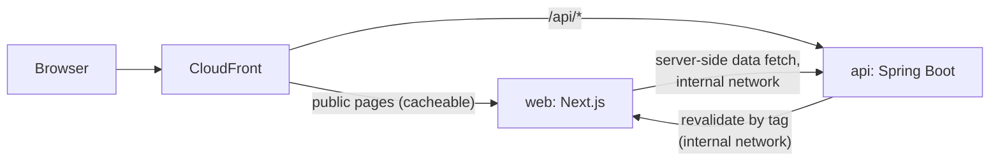

# BlackPages.io: Frontend Architecture

| | |
|---|---|
| **Version** | 1.0 |
| **Date** | 2026-09-30 |
| **Status** | Draft for review by the `directory-app-ui` tech lead before Sprint 1 |
| **Repository** | `directory-app-ui` |
| **Related** | ADR-0002 (Next.js), ADR-0006 (sessions), ADR-0007 (authorization), ADR-0012 (contract-first API), ADR-0019 (frontend platform), System Overview v1.2, API Style Guide v1.0, Identity and Access Design v2.2, SPEC-BILL-01 v0.5 |

This document describes **how the web app is built**: rendering, data access, authentication in the UI, error handling, SEO, analytics, styling, the Keycloak login theme, testing, and deployment. The backend is the authority for every business rule. The frontend's job is to present data well, quickly, and accessibly.

---

## 1. Principles

1. **The backend decides; the frontend presents.** No business rule, price calculation, or permission check exists only in the frontend. The UI may hide what a user can't do, but the API always enforces it (ADR-0007).
2. **Public pages are fast, crawlable, and identical for everyone.** Anything personal is loaded in the browser after the page arrives, so public HTML can be cached at the CDN.
3. **One way to call the API:** the generated, typed `@blackpages/api-client`. No hand-written `fetch` calls to `/api`.
4. **Logic lives in `src/features/`**, where it can be unit-tested. Route files (`page.tsx`, `layout.tsx`) only compose components and fetch data.
5. **Accessible and fast by default:** WCAG 2.1 AA and the performance budgets in section 11 are acceptance criteria, not extras.

---

## 2. Platform (ADR-0019)

| Component | Choice |
|---|---|
| Framework | **Next.js 16.3.x** (App Router), pinned to the latest patch release |
| UI library | **React 19.x** (the version Next.js 16.3 supports) |
| Language | **TypeScript** in strict mode |
| Runtime | **Node.js 24 LTS**, ARM64 container images |
| Bundler | Turbopack (the Next.js 16 default) |
| Styling | **Tailwind CSS** with BlackPages design tokens, plus **Radix UI** primitives for accessible interactive components |
| Server data in the browser | **TanStack Query** |
| Forms | **React Hook Form** with **Zod** schemas |
| API client | `@blackpages/api-client`: types generated with `openapi-typescript`, calls made with `openapi-fetch` |
| Maps | Google Maps JavaScript API through `@vis.gl/react-google-maps`, loaded only in the browser and only when needed |
| Login theme | **Keycloakify**, in `keycloak-theme/` |
| Testing | **Vitest**, React Testing Library, **MSW** for API mocks, **Playwright** for end-to-end tests, axe for accessibility |

---

## 3. Application structure

```
directory-app-ui/
├── src/
│   ├── app/                              # routes only: compose features, fetch data
│   │   ├── (public)/                     # server-rendered, cacheable, identical for everyone
│   │   │   ├── page.tsx                  #   /
│   │   │   ├── directory/[category]/…    #   /directory/{category}[/{city}[/{specialty}]]
│   │   │   ├── member/[slug]/page.tsx    #   /member/{slug}   (listing profile)
│   │   │   ├── pricing/page.tsx
│   │   │   └── (legal)/privacy, terms, about, contact
│   │   ├── (member)/app/…                # business and shopper dashboards (client data)
│   │   ├── (admin)/admin/…               # admin console (staff with MFA only)
│   │   ├── onboarding/…                  # account type, location, first listing, payment hand-off
│   │   ├── sitemap.xml/route.ts          # proxies the backend's sitemaps (cached)
│   │   ├── robots.txt/route.ts
│   │   ├── _internal/revalidate/route.ts # called by the backend only (section 5.3)
│   │   ├── layout.tsx, error.tsx, not-found.tsx
│   ├── proxy.ts                          # Next.js 16 request proxy (formerly middleware): route protection
│   ├── features/                         # all logic: one folder per domain area
│   │   ├── search/  directory/  listing-profile/  listing-editor/
│   │   ├── tiers/  billing/  reviews/  messaging/  secret-shopper/
│   │   ├── auth/  onboarding/  analytics/  consent/  seo/  admin/
│   ├── components/ui/                    # design system: buttons, inputs, cards, badges, dialogs…
│   ├── lib/
│   │   ├── api/                          # client setup, error mapping, server-side fetch helper
│   │   ├── config/                       # typed environment configuration
│   │   └── observability/                # logging, trace propagation, Web Vitals
│   └── styles/                           # Tailwind configuration, design tokens
├── keycloak-theme/                       # Keycloakify login, registration, and email theme (section 13)
├── tests/
│   ├── unit/                             # Vitest + React Testing Library + MSW
│   └── e2e/                              # Playwright
└── mocks/                                # MSW handlers generated from the API contract
```

**Inside a feature folder:** `components/` (feature UI), `hooks/` (TanStack Query hooks and other hooks), `api.ts` (typed calls through the shared client), `schemas.ts` (Zod form schemas), `model.ts` (pure functions such as formatting tier prices or listing hours), and tests beside the code.

**Dependency rules** (enforced with ESLint import rules):
- `app/` can import from `features/`, `components/`, and `lib/`.
- `features/` can import from `components/`, `lib/`, and **other features' public `index.ts` only**.
- `components/ui/` imports nothing from `features/`.

---

## 4. Rendering strategy

| Route group | Rendering | Caching | Personal data |
|---|---|---|---|
| `(public)`: home, directory pages, listing profiles, pricing, legal pages | **Server-rendered**, with static generation and on-demand regeneration where possible | CDN and Next.js cache. Regenerated by tag when data changes (section 5.3). | **None in the HTML.** The header's signed-in state, "Edit my listing" links, and similar are loaded in the browser after the page arrives. |
| `(member)/app` | Server-rendered shell; data loaded in the browser with TanStack Query | `Cache-Control: private, no-store` | Yes |
| `(admin)/admin` | Same as member | `private, no-store` | Yes |
| `onboarding` | Same as member | `private, no-store` | Yes |



**Why public pages carry no personal data:** if they did, the CDN couldn't cache them safely, and a cached page could show one user's state to another. Signed-in elements on public pages are small client components that call `/api/auth/me` after the page loads.

---

## 5. Data access

### 5.1 The API client
- `@blackpages/api-client` is generated from `contract/openapi.yaml` in `directory-app-svc` and published to GitHub Packages (ADR-0012). The UI pins a version and upgrades deliberately.
- `src/lib/api/client.ts` creates **two clients**:
  - **In the browser:** base URL `/api` (same origin). It sends cookies automatically, and adds the `X-XSRF-TOKEN` header, read from the `XSRF-TOKEN` cookie, on every request that changes data.
  - **On the server** (server components and route handlers): base URL is the **internal API address** (`API_INTERNAL_URL`, for example `http://api.internal:8080/api`). This avoids sending server-side calls out through the ALB and CDN. Each call **forwards the incoming `Cookie` header** and the trace context (section 12).
- Errors are turned into a typed `ApiProblem` (section 7) by one shared function. Features never parse error bodies themselves.

### 5.2 Fetching patterns

| Where | Pattern |
|---|---|
| Public server components | `await` the server client directly in the component. Tag the request for regeneration, for example `listing:{id}`, `directory:{category}:{city}`, `taxonomy`. |
| Dashboards and admin | **TanStack Query** hooks in `features/*/hooks`. Query keys follow `[feature, resource, params]`. Changes invalidate the queries they affect. |
| Changes (create, update, delete) | **Always called from the browser to the backend API**, through TanStack Query mutations. **Next.js Server Actions aren't used** for business operations: they would add a second request path and a second CSRF model, and the backend must stay the single entry point. |

### 5.3 Regenerating public pages when data changes
- The backend publishes events such as `ListingPublished`, `ListingUpdated`, `ListingEntitlementsChanged`, `ReviewsUnlocked`, and `TaxonomyChanged` (System Overview, section 8.4).
- An event handler in the `seo` module calls the web app's **internal** endpoint `POST /_internal/revalidate` with a list of cache tags and a shared secret (`REVALIDATE_SECRET`). The web app then regenerates the affected pages.
- **`/_internal/*` is blocked at the ALB** for public traffic. It's only reachable on the internal network.
- CloudFront paths for the affected pages are invalidated at the same time, with short HTML TTLs as a backstop.

### 5.4 Mock-first development
- MSW handlers in `mocks/` are generated from the agreed contract **before** the backend is ready, so frontend work starts in the same sprint (ADR-0012).
- The same handlers are used in unit tests and in local development (`npm run dev:mock`).
- Before a story is done, the UI switches to the published client version and passes the Playwright tests against the pinned backend image.

---

## 6. Authentication and authorization in the UI

| Concern | Approach |
|---|---|
| Sign in and register | Full-page redirect to `/api/auth/login?returnTo=…` or `/api/auth/register?returnTo=…`. The backend runs the Keycloak flow (ADR-0006). **The frontend never handles tokens.** |
| Sign out | A POST form to `/api/auth/logout` with the CSRF token |
| Who's signed in | `GET /api/auth/me` returns the user, account type, roles, assigned locations (staff), the business account's listings with their tiers, account entitlements, onboarding status, and whether staff MFA is verified |
| Route protection | **`proxy.ts`** (Next.js 16's request proxy) only checks whether a session cookie exists for `(member)`, `(admin)`, and `onboarding`, and redirects to login if not. The **layouts** for those groups call `/api/auth/me` on the server and redirect when onboarding is pending, the user isn't staff, or staff MFA isn't verified. **The backend still enforces everything.** |
| Owner-only actions | Upgrade, Downgrade, Add listing, and billing appear only for the business account's owner. In the MVP the owner is the only user (SPEC-BILL-01, BR-PE-38 and BR-PE-39). |
| Locked features | Shown, not hidden, with a prompt to move that listing up a tier (BR-PE-33). Driven by the listing's entitlements in `/api/auth/me`, and by the `ENTITLEMENT_*` error codes (section 7). |
| Profile switching | **Pending to-do T3.** If approved, `/api/auth/me` returns an active profile and the available profiles, and a switcher in the header changes it. This document will be updated then. |

---

## 7. Error handling

Every API error is an RFC 9457 Problem Details body with a stable `code` (API Style Guide, section 8). One mapping decides what the user sees:

| Code (HTTP status) | What the UI does |
|---|---|
| `UNAUTHENTICATED` (401) | Redirect to `/api/auth/login?returnTo=<current page>` |
| `ONBOARDING_REQUIRED` (403) | Redirect to `/onboarding` |
| `STAFF_MFA_REQUIRED` (403) | Redirect to the Keycloak OTP setup flow |
| `NOT_FOUND` (404) | Server components call `notFound()`, which renders the branded 404 page. In dashboards, show "This item doesn't exist or you don't have access". |
| `VALIDATION_FAILED` (400) | Map `errors[].field` onto form fields through React Hook Form. Show a summary at the top of the form for screen readers. |
| `ENTITLEMENT_LIMIT_REACHED` (422) | `<TierLimitPrompt>`: "3 of 3 photos on this Gold listing. Platinum allows 6." The upgrade action is shown to the owner. |
| `ENTITLEMENT_NOT_INCLUDED` (403) | `<LockedFeature>` with the tier that includes it |
| `ACCOUNT_LAPSED` (402) | A banner with a link to update payment |
| `CONFLICT` (409) | "This was changed elsewhere." Offer to reload the latest version. |
| `RATE_LIMITED` (429) | A friendly message using `Retry-After`. Retry automatically only for safe GET requests. |
| `UPSTREAM_UNAVAILABLE` (503) or any 5xx | Error boundary with a retry button and the **trace ID**, so support can find the request in the logs |

- **Error boundaries:** `app/error.tsx` at the root and in each route group. Feature-level boundaries are used around widgets that fail on their own, such as the map or a dashboard chart.
- **No silent failures:** every mutation shows a success or failure toast that screen readers announce.

---

## 8. Forms and validation
- **React Hook Form with Zod.** Zod schemas mirror the API's constraints for instant feedback. **The API's validation is the authority**, and its field errors are always shown (section 7).
- Schemas live in `features/*/schemas.ts`. Where practical, they're derived from the generated OpenAPI types so field names stay in step.
- Monetary amounts are always displayed from the API's integer cents and currency, using `Intl.NumberFormat`. **The UI never calculates prices, discounts, proration, or tax.** Checkout and tier-change previews come from the backend.
- Business hours are edited and displayed in the **listing's time zone** (Arizona: `America/Phoenix`), as returned by the API.

---

## 9. SEO

| Item | Approach |
|---|---|
| Metadata | `generateMetadata` in each public route reads the `seo` block (title, description, canonical URL, index setting, Open Graph) returned by the backend with the page data. Templates and overrides live in the backend (backlog 6.3, 6.9). |
| Structured data | JSON-LD built from the backend's `schema` block and rendered in a `<script type="application/ld+json">` tag. Rules in SPEC-BILL-01 apply: for example, `sameAs` only for Platinum listings, and `AggregateRating` only once reviews are unlocked. |
| Sitemaps and robots | `sitemap.xml` and `robots.txt` route handlers proxy the backend's generated files and cache them |
| Low-content pages | Pages the backend marks `noindex` (fewer than 3 listings) get `robots: noindex` and are left out of sitemaps |
| URLs | `/member/{slug}` and `/directory/{category}/{city}/{specialty}` (the specialty pattern depends on MVP question Q8). Slug changes are 301-redirected by the backend's redirect data. |
| Performance | Public pages meet Core Web Vitals (section 11). Maps and other heavy widgets are loaded only when scrolled into view. |

---

## 10. Styling, design system, and accessibility
- **Design tokens** (color, typography, spacing, radius, shadows) are defined once in `src/styles/tokens` and used by Tailwind, the components, **and the Keycloak theme**, so login pages match the site.
- **Components** in `components/ui/` are built on **Radix UI** primitives for keyboard and screen-reader support. Each component documents its accessibility behavior.
- **Tier badges** use color **and** a text label, never color alone.
- **Accessibility checks:**
  - automated: axe in component tests and in Playwright on every key page;
  - manual: a WCAG 2.1 AA audit before launch (backlog 15.2).
- **Responsive:** designed mobile-first, because most local directory searches happen on phones.
- **Language:** US English only in the MVP. All user-facing text lives in components or message files rather than being scattered through logic, so translation can be added later.

---

## 11. Performance budgets

| Metric | Budget (public pages, mobile, 75th percentile) |
|---|---|
| Largest Contentful Paint (LCP) | < 2.5 s |
| Cumulative Layout Shift (CLS) | < 0.1 |
| Interaction to Next Paint (INP) | < 200 ms |
| First-load JavaScript (compressed) | < 150 KB on directory pages and listing profiles |

**How they're met**
- Server components by default. Client components only where there's interaction.
- `next/image` with a loader that serves listing media from CloudFront in the right sizes, with explicit dimensions to prevent layout shift.
- Google Maps is loaded only when the map is opened or scrolled into view. List pages use static map images (backlog 5.9).
- Fonts are self-hosted with `next/font`.

**How they're checked**
- **Lighthouse CI** on key pages in every pull request.
- Real-user Web Vitals are reported to analytics after consent.

---

## 12. Analytics, consent, and observability
- **Consent:** a consent banner (backlog 11.3) stores the visitor's choice. **No non-essential tracking runs until they opt in.**
- **Event tracking:** `features/analytics` sends events defined in the event taxonomy (story 0.5) to `POST /api/public/events` with `navigator.sendBeacon`, so tracking never slows the page. Events carry IDs, never emails or names.
- **Visitor state for demand tracking:** pending to-do T10. If approved, the **backend** derives the visitor's state from CloudFront headers, so the frontend sends nothing extra.
- **Logging:** structured JSON logs from the Next.js server, with a request ID and trace ID.
- **Tracing:** the server-side API client forwards W3C `traceparent` headers so a page render can be followed into the backend (System Overview, section 8.9).
- **Error reporting:** unhandled client errors are reported, with the trace ID, to the logging pipeline.

---

## 13. The Keycloak login theme (Keycloakify)
- `keycloak-theme/` holds the login, registration, OTP setup and entry, password reset, required-action, and email templates, built with **Keycloakify** in React with the shared design tokens (identity design, section 10).
- The theme is developed and reviewed in **Storybook**, using Keycloakify's page mocks, so it can be built without a running Keycloak.
- CI builds `blackpages-keycloak-theme-<version>.jar` and publishes it as an artifact. `directory-app-infra` pins the version in the Keycloak image (ADR-0016).
- The theme is held to the same accessibility and testing standards as the web app. Playwright covers the real login and registration flow against the local Keycloak.

---

## 14. Security
- **Content-Security-Policy** with nonces for scripts. It allows only our origins, Google Maps, the CAPTCHA provider (Turnstile), and Stripe's checkout redirect. It sets `frame-ancestors 'none'`.
- Also set: **HSTS**, `Referrer-Policy: strict-origin-when-cross-origin`, a restrictive `Permissions-Policy`, and `X-Content-Type-Options: nosniff`.
- **Payments:** Stripe Checkout is a redirect, so card details never reach our pages (PCI SAQ-A, ADR-0009).
- **Secrets:** only `NEXT_PUBLIC_*` variables reach the browser. These are limited to values that are safe to expose, such as the Google Maps browser key, which is restricted by HTTP referrer. Everything else is server-only.
- **User content:** text from listings, reviews, and messages is always rendered as text, never as raw HTML. Rich descriptions are sanitized by the backend and rendered through an allow-list.

---

## 15. Configuration and environments

| Variable | Where | Example (staging) |
|---|---|---|
| `API_INTERNAL_URL` | Server only | `http://api.internal:8080/api` |
| `REVALIDATE_SECRET` | Server only (Secrets Manager) | — |
| `NEXT_PUBLIC_SITE_URL` | Browser | `https://staging.blackpages.io` |
| `NEXT_PUBLIC_GOOGLE_MAPS_KEY` | Browser (referrer-restricted) | — |
| `NEXT_PUBLIC_TURNSTILE_SITE_KEY` | Browser | — |
| `CDN_MEDIA_URL` | Server and browser | `https://media.staging.blackpages.io` |

Configuration is validated at startup with Zod in `src/lib/config`. The app fails fast if anything is missing.

---

## 16. Testing

| Level | Tools | Scope | Gate |
|---|---|---|---|
| Unit and component | Vitest, React Testing Library, MSW, axe | `src/features/**` and `src/components/**` | **95%** of lines, statements, and functions; **90%** of branches |
| Contract | Generated MSW handlers and the published client types | Type-check against the pinned `@blackpages/api-client` | TypeScript build |
| End to end | Playwright (Chromium in every pull request; Firefox and WebKit nightly) | Key journeys: search, view a listing, register, onboard, pay (Stripe test mode), add a listing, upgrade, message, review, admin moderation | All pass against the pinned backend image |
| Accessibility | axe (component and Playwright) | Every component and key page | No serious or critical violations |
| Performance | Lighthouse CI | Home, a directory page, a listing profile | Budgets in section 11 |

Route files (`page.tsx`, `layout.tsx`) are excluded from unit coverage and covered by Playwright instead, which is why logic must stay in `features/`.

---

## 17. Build and deployment
- `next build` with **`output: "standalone"`**, packaged in a Node.js 24 ARM64 image and pushed to GHCR (ADR-0013).
- It runs on ECS Fargate behind the ALB (ADR-0014). Health check: `GET /_internal/health`.
- **CDN rules:**
  - public routes send `Cache-Control: public, s-maxage=…, stale-while-revalidate=…`;
  - `(member)`, `(admin)`, and `onboarding` send `private, no-store`;
  - `/_internal/*` is never routed from the internet.
- Rolling deploys. Static assets have content hashes, so old and new versions can be served side by side during a deploy.

---

## 18. Open items
- **T3 (profile switching):** affects `/api/auth/me`, the header, and route protection.
- **T10 (demand by state):** affects only the backend and privacy text. Possibly a "notify me when we launch" form in the location selector.
- **Q8 (specialty URL pattern):** affects the route structure under `directory/`.
- **Design system and screen mockups:** needed before Sprint 2 and Sprint 3 (see the documentation plan).
