# BlackPages.io: System Architecture Overview

| | |
|---|---|
| **Version** | 1.3 (2026-10-06: service areas are lists of cities, Q5. v1.2, 2026-09-30: frontend platform and API conventions now in the Frontend Architecture and API Style Guide. v1.1: backend on Spring Boot 4.1 and Java 25.) |
| **Date** | 2026-09-30 |
| **Status** | Draft for review by both tech leads before Sprint 1 |
| **Owners** | Tech leads for `directory-app-svc` and `directory-app-ui` |
| **Related** | ADR-0001 to ADR-0019, Frontend Architecture v1.0, API Style Guide v1.0, Identity and Access Design v2.2, SPEC-BILL-01 v0.5, MVP Definition v1.9, Product Backlog v1.5 |

This document gives the **big picture**: how the system fits together, what each part owns, and the rules that apply everywhere. It links to the ADRs for *why* each decision was made, and to the specs for detailed business rules. Diagrams are written in Mermaid so they're reviewed and versioned like code.

---

## Contents

1. [System context](#1-system-context)
2. [Containers](#2-containers)
3. [Backend modules](#3-backend-modules)
4. [Frontend structure](#4-frontend-structure)
5. [Data model](#5-data-model)
6. [Key runtime flows](#6-key-runtime-flows)
7. [Deployment](#7-deployment)
8. [Cross-cutting concepts](#8-cross-cutting-concepts)
9. [Quality targets](#9-quality-targets)
10. [Risks and technical debt](#10-risks-and-technical-debt)
11. [Glossary and references](#11-glossary-and-references)

---

## 1. System context

**What BlackPages is:** a multi-location business directory, launching in Arizona. There are two **account types**:
- **Business accounts** have exactly one user, the owner. Each account can have any number of listings, and every listing has its own **tier** (Silver, Gold, or Platinum). A default Silver listing is created with every new account.
- **Shopper accounts** are for individuals who review businesses and can be selected as secret shoppers.

Reviews of a listing stay hidden until a secret shopper has reviewed it.

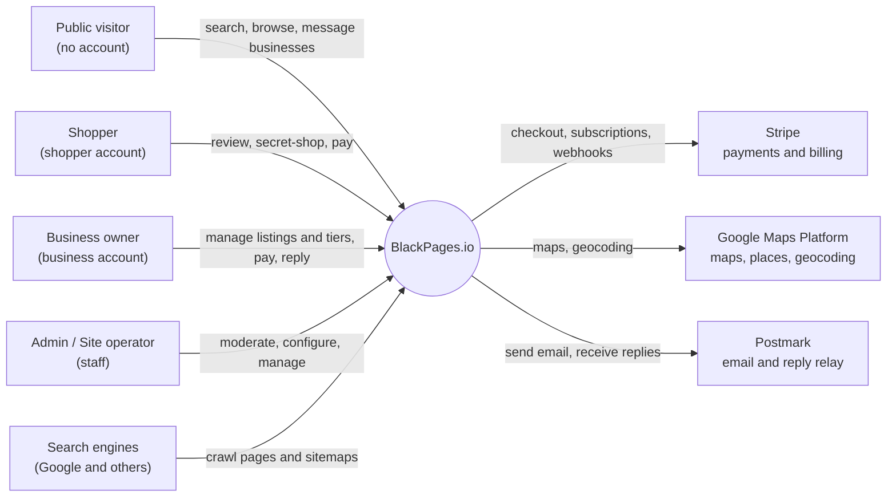

| Actor or system | Interaction | Reference |
|---|---|---|
| Public visitor | Searches, browses, views listings and unlocked reviews, and sends messages to businesses without an account | MVP section 2 |
| Shopper | Pays the shopper account price plus the $1 fee, writes reviews, and completes secret shopper assignments | SPEC-BILL-01 BR-PE-40 |
| Business owner | The account's only user. Manages listings and their tiers, pays, and replies to reviews and messages. | SPEC-BILL-01 BR-PE-38, BR-PE-39 |
| Admin and site operator | Staff who must use MFA. Admins can write to all locations. Operators can write only to their assigned locations. | ADR-0007, ADR-0008 |
| Stripe | Card entry, one subscription per account, invoices, and webhooks | ADR-0009, ADR-0017 |
| Google Maps Platform | Map views, Places Autocomplete, and geocoding | Backlog 3.4, 5.3, 5.9 |
| Postmark | Transactional email, Keycloak authentication email, and the inbound relay for message replies | ADR-0015 |
| Search engines | Crawl server-rendered pages and sitemaps | Backlog E6 |

---

## 2. Containers

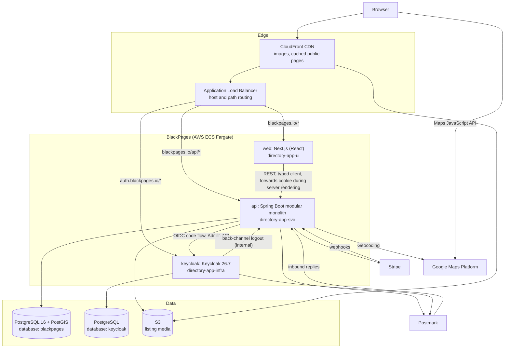

| Container | Technology | Repository | Responsibility | Reference |
|---|---|---|---|---|
| **web** | Next.js (React). Server-rendered public pages; client-rendered member dashboard and admin console. | `directory-app-ui` | All web pages. Keeps no business rules. Reads the user from `/api/auth/me` only to show or hide UI. | ADR-0002 |
| **api** | **Spring Boot 4.1, Java 25**, Spring Modulith, virtual threads | `directory-app-svc` | All business logic, authorization, and data. Acts as the only OIDC client and holds server-side sessions. | ADR-0001, ADR-0006 |
| **keycloak** | Keycloak 26.7.x, custom optimized image, Keycloakify theme | `directory-app-infra` (image), `directory-app-ui` (theme) | Authentication only: credentials, login, registration, MFA | ADR-0005, ADR-0016 |
| **blackpages database** | PostgreSQL 16 with PostGIS, `pg_trgm`, `unaccent` | `directory-app-svc` (Flyway) | Application data, sessions, outbox, analytics events | ADR-0003 |
| **keycloak database** | PostgreSQL, same RDS instance, separate role | Managed by Keycloak | Keycloak's own data | ADR-0016 |
| **S3 and CloudFront** | Object storage and CDN | `directory-app-infra` | Listing media, cached public pages | ADR-0014 |

**Routing rules:**
- The browser sees **one origin**, `blackpages.io`, for pages and API calls, so there's no CORS and the session cookie works during server rendering.
- Keycloak is on `auth.blackpages.io`. Its `/admin/*` paths are restricted to allowed IP ranges.

---

## 3. Backend modules

The backend is a **modular monolith** with **15 modules**. Modules talk to each other only through each module's `api` package (synchronous calls) or through **domain events** published via the transactional outbox. Spring Modulith and ArchUnit tests enforce these boundaries on every build.

> **Change from ADR-0001:** `entitlement` is a module in its own right, split out of `billing`, because almost every module reads entitlements and `billing` shouldn't become a dependency hub (SPEC-BILL-01, section 10).

### 3.1 Module responsibilities

| Module | Owns | Main tables | Publishes | Epics |
|---|---|---|---|---|
| `location` | Locations (states), cities, time zones, location context | `location`, `city` | `LocationActivated` | E1 |
| `identity` | Users, the Keycloak link, roles, operator assignments, business and shopper account records, onboarding, sessions | `app_user`, `user_identity`, `user_role`, `operator_location`, `business_account`, `business_account_member`, `shopper_profile`, `invitation`, Spring Session tables | `UserRegistered`, `UserEmailChanged`, `UserDisabled`, `UserDeleted`, `OnboardingCompleted` | E2 |
| `taxonomy` | Categories, subcategories, specialties | `category`, `subcategory`, `specialty` | `TaxonomyChanged` | E4 |
| `listing` | Listings, media, hours, links, service areas, slugs, approval workflow | `listing`, `listing_*`, `service_area*`, `slug_redirect` | `ListingSubmitted`, `ListingApproved`, `ListingRejected`, `ListingPublished`, `ListingUpdated`, `ListingSlugChanged` | E3 |
| `search` | Keyword, filter, map, and service-area queries behind `SearchPort` | (reads listing tables and search vectors) | — | E5 |
| `billing` | Listing tiers, account pricing, discounts, subscriptions, tier changes | `listing_tier*`, `account_type_config`, `discount`, `discount_redemption`, `subscription`, `subscription_item` | `AccountActivated`, `AccountLapsed`, `AccountReactivated`, `ListingAdded`, `ListingRemoved`, `ListingTierChangeScheduled`, `ListingTierChangeCanceled`, `ListingTierChangeEffective`, `DiscountEnding` | E7 |
| `entitlement` | Entitlement definitions, values by tier and account type, overrides, resolution, caching | `entitlement_definition`, `tier_entitlement`, `account_type_entitlement`, `entitlement_override` | `ListingEntitlementsChanged`, `AccountEntitlementsChanged` | E7 |
| `payment` | Stripe adapter, checkout sessions, webhooks, invoices, refunds | `invoice`, `payment_event` | `PaymentSucceeded`, `PaymentFailed`, `InvoicePaid` | E8 |
| `review` | Reviews, replies, flags, moderation, the unlock gate, ratings | `review`, `review_response`, `review_flag` | `ReviewSubmitted`, `ReviewModerated`, `ReviewsUnlocked` | E9 |
| `secretshopper` | Monthly selection, assignments, surveys, evaluations | `ss_selection_run`, `ss_selection`, `ss_assignment`, `survey*` | `SecretShoppersSelected`, `AssignmentCreated`, `EvaluationSubmitted` | E10 |
| `messaging` | Visitor contact form, threads, email relay, spam controls | `message_thread`, `message` | `MessageReceived`, `MessageReplied` | E16 |
| `analytics` | Event ingestion, aggregates, dashboard queries | `activity_event` (partitioned), aggregate tables | — | E11, E12 |
| `seo` | Metadata templates, overrides, sitemaps, redirects, schema data, index rules | `seo_template`, `seo_override` | `SitemapRegenerated` | E6 |
| `admin` | Moderation queues, member management, audit log | `audit_log` | — | E14 |
| `notification` | Email templates and delivery through Postmark | (uses `outbox_event`) | — | Shared |

Shared infrastructure lives in `io.blackpages.shared`: security configuration, `LocationContext`, error handling, the outbox, clock and ID providers, and web configuration.

### 3.2 Module dependencies

Arrows show allowed synchronous calls through `api` packages. Everything else goes through events (section 8.4).

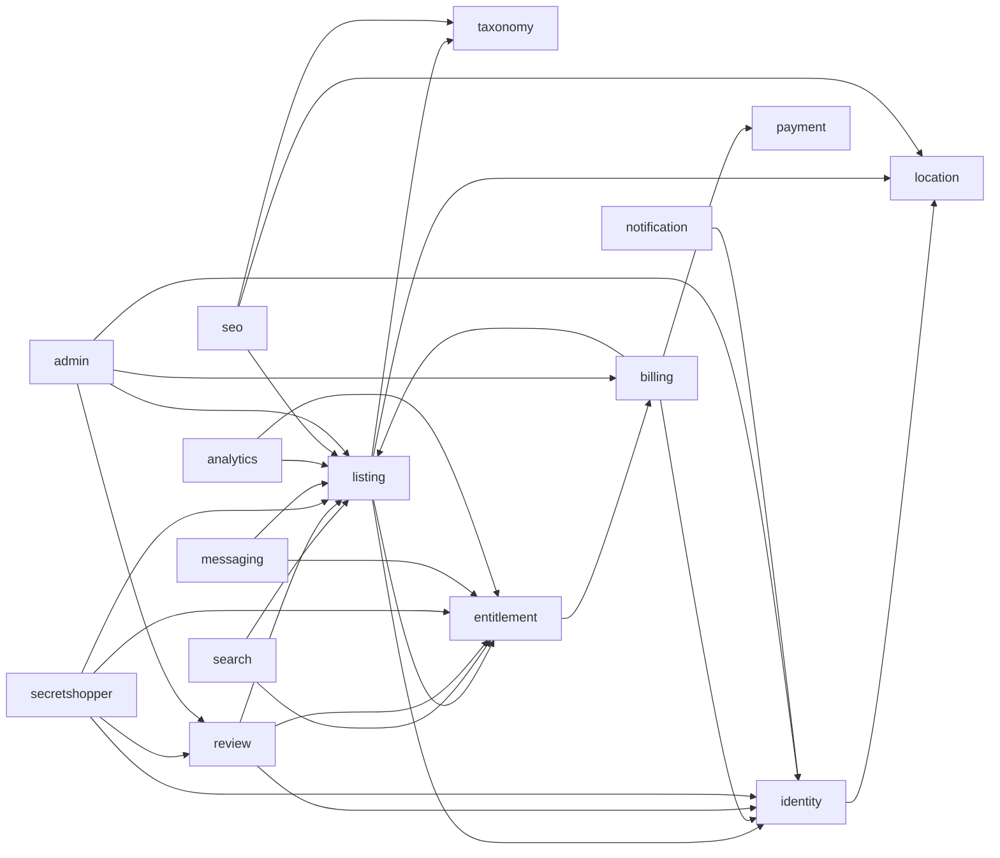

**Rules:**
- There must be **no cycles**. Where one would form, the dependency goes through an event instead. For example, `billing` doesn't call `entitlement`; `entitlement` reacts to billing events.
- **Only `billing` and `entitlement` read the tier and pricing tables** (SPEC-BILL-01, BR-PE-16).
- **Only `identity` imports Spring Security OAuth2 or Keycloak types.** Other modules use `CurrentUser` (ADR-0007).
- `notification` depends on nothing except `identity` (to look up recipients). It's driven entirely by events.

### 3.3 Backend platform (ADR-0018)

| Component | Version or choice | Notes |
|---|---|---|
| Java | **25 (LTS)**, Eclipse Temurin, ARM64 images | Virtual threads enabled for requests and `@Async` work |
| Spring Boot | **4.1.x**, latest patch (4.1.1 at the time of writing) | Manages the versions of the libraries below. Managed versions aren't overridden. |
| Spring Framework / Spring Security | 7.x | Lambda-style security configuration only |
| Jakarta EE / Servlet | 11 / 6.1 | `jakarta.*` packages |
| Persistence | Spring Data JPA with Hibernate (Boot-managed), Flyway, PostgreSQL JDBC | Hibernate filters for location scoping (ADR-0008) |
| JSON | **Jackson 3** (`tools.jackson.*`) | Jackson 2 imports are blocked in our code by ArchUnit |
| Starters | Boot 4 modular starters: `webmvc`, `security`, `security-oauth2-client`, `flyway`, `validation`, plus Data JPA, Actuator, and Spring Session JDBC | Test starters use the `-test` suffix |
| Keycloak Admin API | Spring `RestClient`, behind `UserProvisioningPort` | Instead of `keycloak-admin-client` (ADR-0018, decision 5) |
| Architecture checks | Spring Modulith, ArchUnit | Versions compatible with Boot 4 and Java 25 |
| Testing | JUnit (Boot-managed), AssertJ, Mockito, Testcontainers, PIT, JaCoCo | Versions confirmed in story 0.7 |

### 3.4 Package layout (each module)

```
io.blackpages.<module>/
├── api/             # public facade (interfaces and records), REST controllers, request/response DTOs
├── application/     # use-case services, event handlers
├── domain/          # entities, value objects, domain events, policies
└── infrastructure/  # repositories, external adapters (Stripe, Keycloak, Postmark, Google)
```

REST controllers implement interfaces generated from `contract/openapi.yaml` (ADR-0012).

---

## 4. Frontend structure

**The full design is in the Frontend Architecture** (`docs/architecture/frontend.md`): Next.js 16.3, React 19, Node.js 24 (ADR-0019). This section is a summary.

```
directory-app-ui/
├── src/app/
│   ├── (public)/                 # server-rendered, cacheable: SEO pages
│   │   ├── page.tsx              #   /
│   │   ├── directory/…           #   /directory/{category}/{city}/{specialty}
│   │   ├── member/[slug]/…       #   /member/{slug}  (listing profile)
│   │   └── pricing/…
│   ├── (member)/app/…            # business owner and shopper dashboards (client-rendered)
│   ├── (admin)/admin/…           # admin console (client-rendered, staff with MFA only)
│   ├── onboarding/…
│   └── proxy.ts                  # Next.js 16 request proxy: route protection (see the Frontend Architecture)
├── src/features/                 # all logic lives here so unit tests can reach it
├── src/components/ui/            # design system
├── src/lib/api/generated/        # typed client from @blackpages/api-client
└── keycloak-theme/               # Keycloakify login, registration, and email theme
```

| Concern | Approach | Reference |
|---|---|---|
| Rendering | Public pages are rendered on the server and regenerated when listings or taxonomy change. Dashboards render in the browser. | ADR-0002, backlog 6.2 |
| Data access | Only through the generated typed client. During server rendering, the incoming `Cookie` header is forwarded. | ADR-0012 |
| Authentication | Redirects to `/api/auth/login` and `/api/auth/register`. The frontend never handles tokens. | ADR-0006 |
| Authorization in UI | `/api/auth/me` decides what's visible. The backend always enforces the rules. | ADR-0007 |
| Entitlement prompts | Locked features are shown with a prompt to move that listing up a tier, driven by `ENTITLEMENT_*` error codes | SPEC-BILL-01, BR-PE-33 and BR-PE-34 |
| Testing | Vitest for `features/` and components (95% gate). Playwright for pages and user journeys. | Backlog 0.3 |

---

## 5. Data model

All tables live in the `blackpages` database. Primary keys are UUIDs. Every table scoped to a location has `location_id NOT NULL` (ADR-0008). All entities have `created_at`, `updated_at`, and a `version` column for optimistic locking. These columns aren't shown below.

### 5.1 Accounts and identity

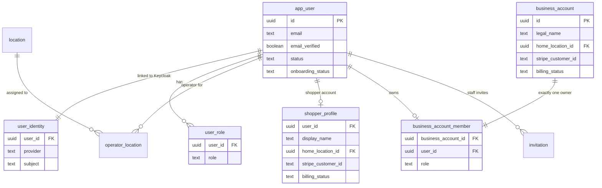

**Rules:** `business_account_member` has exactly one row per account, with role `OWNER`, enforced by a unique constraint on `business_account_id` (SPEC-BILL-01, BR-PE-39). `invitation` is used only for staff in the MVP.

### 5.2 Locations, taxonomy, and listings

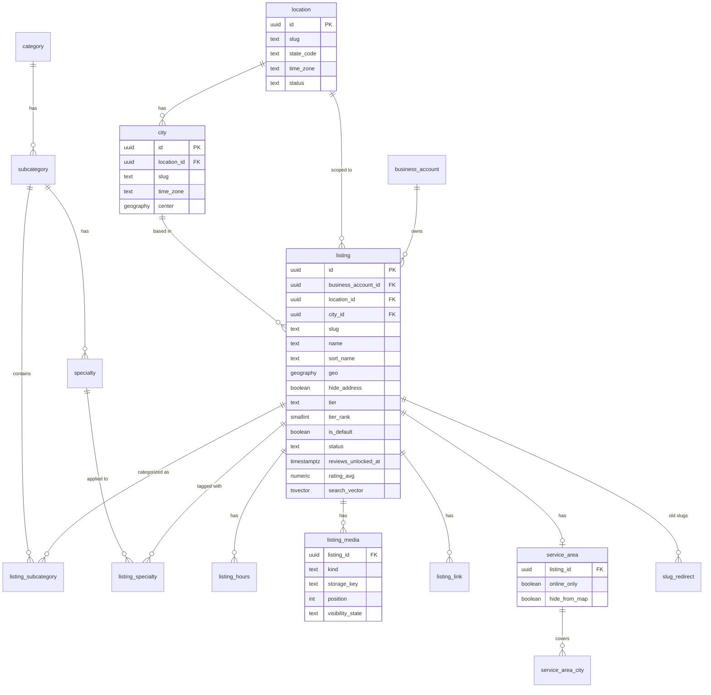

**Key indexes:**
- `listing (location_id, status, tier_rank DESC, sort_name)` serves directory ordering (SPEC-BILL-01, BR-PE-30).
- GiST indexes on `listing.geo` and `city.center` serve map and distance queries. Service areas are lists of cities (`service_area_city`), matched by city ID.
- GIN indexes on `search_vector`, and trigram GIN on `sort_name`, serve search.

`tier` and `tier_rank` are **copies** kept in step by `ListingEntitlementsChanged`. The source of truth is the listing's subscription item.

### 5.3 Pricing, entitlements, billing, and payments

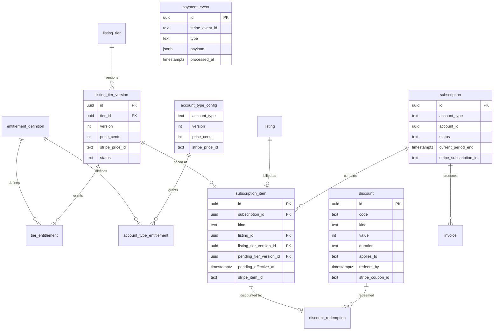

**Rules:**
- There is **one subscription per account** (business or shopper) (ADR-0017).
- Each subscription has these items:
  - `SERVICE_FEE`: $1, never discounted.
  - `LISTING`: one item per listing, including the default Silver listing.
  - `SHOPPER_ACCOUNT`: for shopper accounts only.
- A discount can attach only to `LISTING` or `SHOPPER_ACCOUNT` items, never to `SERVICE_FEE`.
- `payment_event.stripe_event_id` is unique, so each webhook is processed only once.

### 5.4 Reviews, secret shopper, messaging, analytics, and platform tables

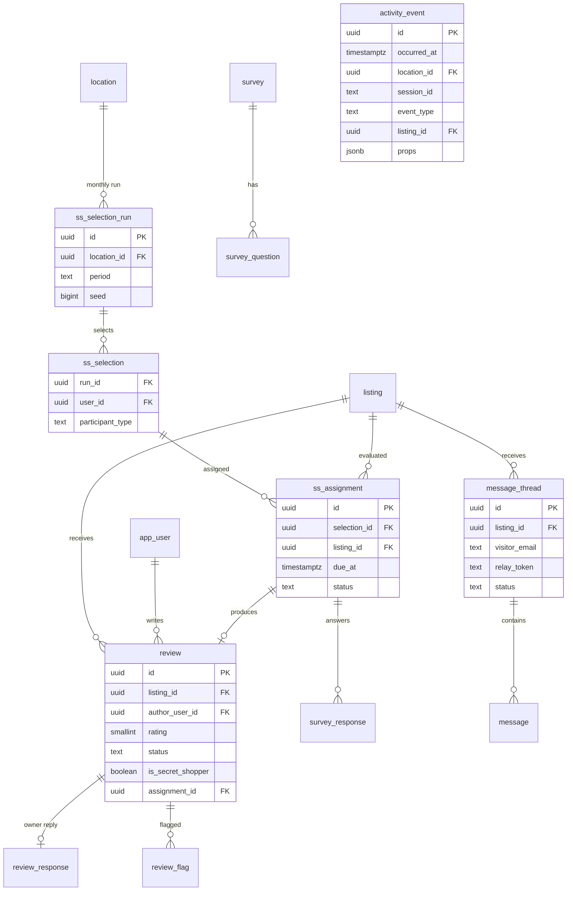

**Platform tables** (not shown):
- `outbox_event` (the transactional outbox)
- `shedlock` (scheduled-job locks)
- `audit_log`
- `seo_template` and `seo_override`
- `spring_session` and `spring_session_attributes`

**Rules:**
- `ss_selection_run (location_id, period)` is unique, so a location can't be selected twice in a month.
- There's one ordinary review per author per listing.
- `activity_event` is partitioned by month on `occurred_at` (ADR-0011).

### 5.5 Migrations

- **Flyway** manages the `blackpages` schema, with one migration stream in `directory-app-svc`. Keycloak manages its own database.
- Migrations follow **expand, then contract**. A deploy adds columns or tables in a backward-compatible way, and a later deploy removes old ones. This allows rolling deploys without downtime.
- Reference data (entitlement definitions, tiers, Arizona and its cities, the default survey) is loaded by versioned Flyway data migrations.

---

## 6. Key runtime flows

### 6.1 Public category page (server-rendered, cached)

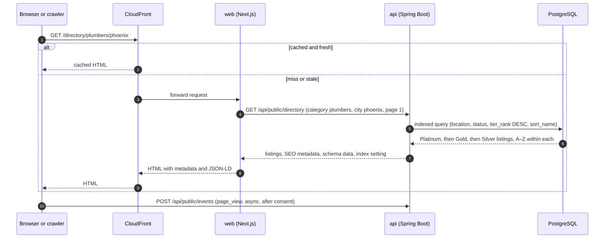

Pages are regenerated when `ListingPublished`, `ListingUpdated`, `ListingEntitlementsChanged`, or `TaxonomyChanged` affect them.

### 6.2 Login

The browser never sees Keycloak tokens. The full flow is in the identity design, section 5.2.

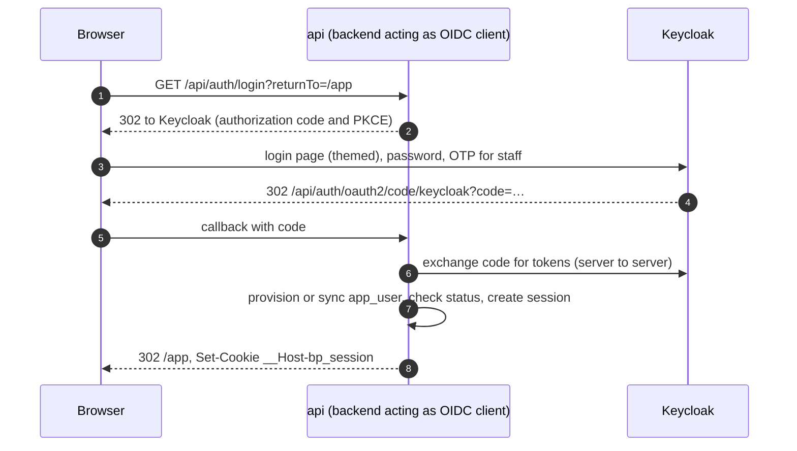

### 6.3 Business signup, default Silver listing, and first payment

```mermaid
sequenceDiagram
    autonumber
    participant B as Browser
    participant A as api
    participant S as Stripe

    B->>A: POST /api/onboarding/business (details, location, tier for first listing)
    A->>A: create business_account, OWNER membership, default Silver listing (draft)
    A->>S: create customer and Checkout session (service fee item, listing item at its tier, discount if any)
    A-->>B: Checkout URL
    B->>S: enter card (hosted by Stripe)
    S-->>A: webhook checkout.session.completed / invoice.paid
    A->>A: payment_event (idempotent), then AccountActivated through the outbox
    A->>A: entitlement resolves the listing and account, then ListingEntitlementsChanged
    A->>A: listing copies tier and tier_rank; the owner can submit the listing for approval
```

### 6.4 Upgrading a listing's tier

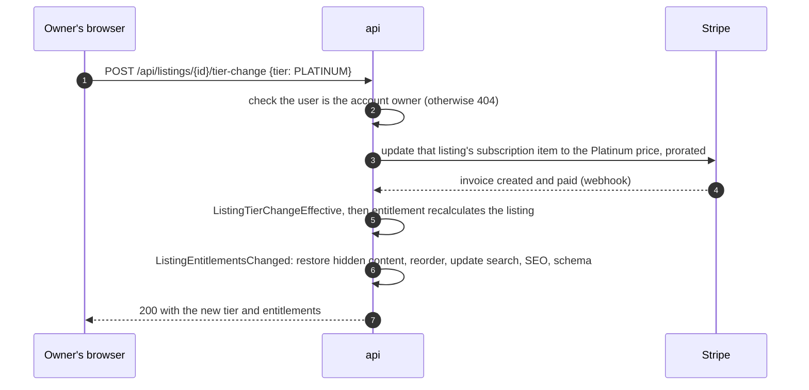

A **downgrade** is stored as a pending change on the subscription item and scheduled for the end of the period. It publishes `ListingTierChangeScheduled`, sends the 7-day email, and can be canceled until it takes effect (SPEC-BILL-01, section 6.4).

### 6.5 Monthly secret shopper selection and review unlock

```mermaid
sequenceDiagram
    autonumber
    participant J as Scheduled job (ShedLock)
    participant SS as secretshopper
    participant ID as identity and entitlement
    participant N as notification
    participant R as review
    participant L as listing

    J->>SS: 00:00 on the 1st, in each location's time zone
    SS->>ID: eligible business and shopper accounts in good standing
    SS->>SS: seeded random 1 in 100 of each (minimum 1), store the run and seed
    SS->>SS: assign listings (not their own, not same-category competitors)
    SS->>N: AssignmentCreated, then a confidential email
    Note over SS,R: later: the secret shopper submits a review and survey
    SS->>R: EvaluationSubmitted
    R->>L: ReviewsUnlocked (sets reviews_unlocked_at)
    L->>L: approved reviews become public; the rating is shown; schema is updated
```

### 6.6 Visitor message and reply relay

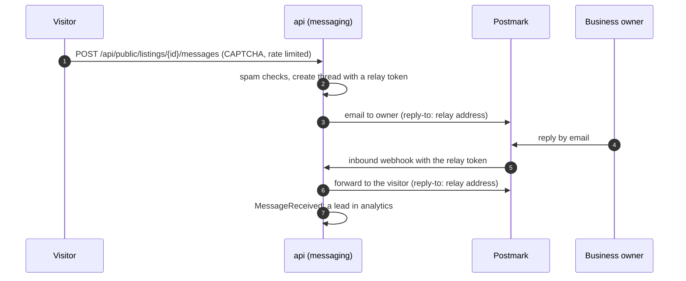

---

## 7. Deployment

### 7.1 AWS (staging and production)

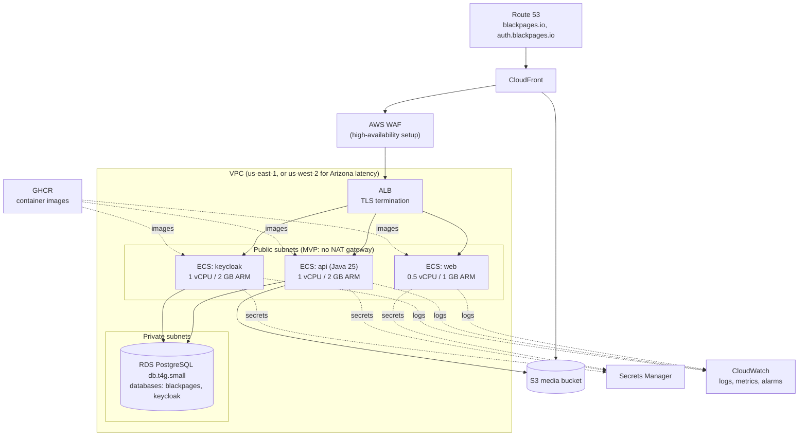

- **Network:** tasks run in public subnets with security groups that accept inbound traffic **only from the ALB**. RDS is in private subnets and accepts connections only from the tasks. There's no NAT gateway in the MVP (ADR-0014).
- **High-availability setup, before scaling beyond Arizona:** two tasks per service, RDS Multi-AZ, WAF, one NAT gateway, and a clustered Keycloak (ADR-0016).
- **Cost:** about $140–160 a month for minimal production and $40–55 for staging, at MVP traffic (ADR-0014).

### 7.2 Environments

| Environment | Purpose | How it runs | Data |
|---|---|---|---|
| **Local** | Development | Backend and frontend on the host. `docker compose` for Postgres with PostGIS, Keycloak, Mailpit, stripe-mock (`directory-app-infra/local`). | Seeded test data |
| **CI** | Automated tests | Testcontainers (Postgres, Keycloak), MockMvc, Playwright against the Docker images | Created per test |
| **Staging** | Integration, demos, UAT | Same Terraform as production at a smaller size, **scheduled for business hours**. Stripe test mode. | Anonymized or synthetic |
| **Production** | Live service | ECS, RDS, CloudFront. Stripe live mode. | Live |

### 7.3 Delivery pipeline

| Step | Backend (`directory-app-svc`) | Frontend (`directory-app-ui`) | Infra (`directory-app-infra`) |
|---|---|---|---|
| Pull request | Build, unit and integration tests, JaCoCo gate (95% lines, 90% branches), PIT, openapi-diff, CodeQL, dependency scan | Lint, type check, Vitest gate (95%), `npm audit`, CodeQL, Playwright against the pinned backend image | `terraform plan`, `keycloak-config-cli` dry run, realm smoke test |
| Merge to `main` | Publish `@blackpages/api-client` and the backend image to GHCR, then deploy to staging | Publish the web image and theme JAR, then deploy to staging | Apply to staging |
| Release | Manual approval, then deploy to production | Manual approval, then deploy to production | Manual approval, then apply to production |

Deployments are rolling ECS updates. Health checks gate each new task before the old one is stopped.

---

## 8. Cross-cutting concepts

### 8.1 Location scoping (ADR-0008)
- Every request resolves a `LocationContext` from the URL, the user's selection, or the resource being accessed.
- A Hibernate filter applies `location_id` to every location-scoped entity. An ArchUnit rule fails the build if a location-scoped repository can be called without a context.
- Each location and city stores an **IANA time zone**. Arizona uses `America/Phoenix`, which has no daylight saving time. The time zone is used for business hours, "open now", and scheduled jobs.

### 8.2 Authentication and sessions (ADR-0005, ADR-0006)
- **Keycloak** authenticates. The backend is the only OIDC client (authorization code with PKCE).
- The browser holds one opaque cookie, `__Host-bp_session`, backed by Spring Session JDBC. CSRF protection uses a cookie token plus the `X-XSRF-TOKEN` header.
- Session lifetimes are set by role: members get 24 hours, or 30 days with remember-me. Staff get a 30-minute idle timeout and an 8-hour maximum.

### 8.3 Authorization and entitlements (ADR-0007, SPEC-BILL-01)

Four layers, all checked by `AuthorizationService` in the backend:

| Layer | Question | Source |
|---|---|---|
| 1. Role | Is this action allowed for SHOPPER, BUSINESS, SITE_OPERATOR, or ADMIN? | `user_role` |
| 2. Location scope | Can this staff member write to this location? | `operator_location` |
| 3. Ownership | Is this user the owner of the business account behind this listing? | `business_account_member` (one OWNER per account) |
| 4. Entitlement | Does this **listing's tier** or this **account's type** include the feature? | `EntitlementService` |

- Resources outside a user's scope return **404**, not 403.
- The **authorization matrix test** runs every OpenAPI operation as every persona. An operation missing from `authz-matrix.yaml` fails the build.

### 8.4 Domain events and the transactional outbox (ADR-0010)
- A module writes its own change **and** an `outbox_event` row in the same database transaction. A worker then publishes the event to listeners inside the application (Spring Modulith event publication).
- Delivery is **at least once**, so every handler must be **idempotent**. Handlers check a natural key or keep a processed-event marker.
- External calls (Stripe updates, Keycloak Admin API, Postmark) are made from event handlers with retries, exponential backoff, and a circuit breaker. They're never made inside the business transaction.

**Event catalogue (MVP):**

| Event | Producer | Main consumers |
|---|---|---|
| `UserRegistered`, `UserEmailChanged`, `UserDisabled`, `UserDeleted`, `OnboardingCompleted` | identity | billing, review, notification, admin |
| `AccountActivated`, `AccountLapsed`, `AccountReactivated` | billing | entitlement, listing, notification |
| `ListingAdded`, `ListingRemoved` | billing | entitlement, listing |
| `ListingTierChangeScheduled`, `ListingTierChangeCanceled`, `ListingTierChangeEffective` | billing | entitlement, notification |
| `DiscountEnding` | billing | notification |
| `ListingEntitlementsChanged` | entitlement | listing, search, seo, analytics |
| `AccountEntitlementsChanged` | entitlement | review, secretshopper |
| `PaymentSucceeded`, `PaymentFailed`, `InvoicePaid` | payment | billing, notification |
| `ListingSubmitted`, `ListingApproved`, `ListingRejected`, `ListingPublished`, `ListingUpdated`, `ListingSlugChanged` | listing | admin, seo, search, notification |
| `TaxonomyChanged` | taxonomy | seo, search |
| `ReviewSubmitted`, `ReviewModerated`, `ReviewsUnlocked` | review | listing, seo, notification, analytics |
| `SecretShoppersSelected`, `AssignmentCreated`, `EvaluationSubmitted` | secretshopper | notification, review |
| `MessageReceived`, `MessageReplied` | messaging | notification, analytics |

### 8.5 Scheduled jobs
All scheduled jobs use `@Scheduled` with **ShedLock on Postgres**, so each runs exactly once even when there are several backend tasks.

| Job | Schedule | Notes |
|---|---|---|
| Secret shopper selection | 00:00 on the 1st, in each location's time zone | Seeded and auditable (backlog 10.1) |
| Tier-change and discount-ending notices | Daily | 7-day warnings (SPEC-BILL-01, BR-PE-24; backlog 7.11) |
| Apply scheduled tier downgrades | Daily, aligned with Stripe period ends | Stripe is the source of truth for timing |
| Lapse check | Daily | 7-day grace period (backlog 7.7) |
| Identity reconciliation | Nightly | Keycloak compared with the application (identity design, section 9) |
| Sitemap regeneration | On events, plus nightly | Backlog 6.4 |
| Analytics aggregates | Hourly and nightly | Backlog 11.2 |
| Expire entitlement overrides | Hourly | SPEC-BILL-01, BR-PE-14 |

### 8.6 API conventions (ADR-0012)

**The full rules are in the API Style Guide** (`docs/architecture/api-guidelines.md`). This section is a summary.
- **Contract-first:** `contract/openapi.yaml` is changed and approved by both teams before implementation.
- **Paths:**
  - `/api/public/*` needs no authentication.
  - `/api/auth/*` covers session and redirect endpoints.
  - `/api/admin/*` is for staff only.
  - Other paths need an authenticated session.
- **Errors** use **RFC 9457 Problem Details** with a stable `code` field. Examples:

  | Code | HTTP status | Meaning |
  |---|---|---|
  | `VALIDATION_FAILED` | 400 | Field errors listed in `errors[]` |
  | `NOT_FOUND` | 404 | Also used for resources outside the user's scope |
  | `ENTITLEMENT_LIMIT_REACHED` | 422 | See SPEC-BILL-01, section 11 |
  | `ENTITLEMENT_NOT_INCLUDED` | 403 | The listing's tier doesn't include the feature |
  | `CONFLICT` | 409 | An optimistic-lock version mismatch |
  | `RATE_LIMITED` | 429 | Includes a `Retry-After` header |

- **Pagination:** page-based (`page`, `size` up to 100) for directory pages, which need crawlable page numbers. Cursor-based for admin and analytics lists.
- **Idempotency:** requests that create charges, such as adding a listing or changing a tier, accept an `Idempotency-Key` header, which is passed on to Stripe.
- **Versioning:** additive changes only. A breaking change needs a major version bump of the client package, and the old field is deprecated for one release first.

### 8.7 Caching

| Layer | What's cached | How it's cleared |
|---|---|---|
| CloudFront | Public HTML and media | Short TTLs on HTML, and targeted invalidation from `seo` events |
| Next.js | Regenerated public pages | Revalidation triggered by the same events |
| Caffeine (in the api process) | Entitlement sets, operator assignments, taxonomy | Evicted on the related events, with a 5-minute TTL as a backstop |

Redis or Valkey is added only when there's more than one api task (ADR-0010).

### 8.8 Search and SEO
- Search uses PostgreSQL full-text search, trigram matching, and PostGIS, all behind `SearchPort` (ADR-0004). Results are always ordered by tier, then alphabetically (SPEC-BILL-01, section 7).
- The `seo` module supplies metadata templates, the index setting (pages with fewer than 3 listings aren't indexed), sitemaps for each location, and 301 redirects when slugs change. The web app renders these (backlog E6).

### 8.9 Observability
- **Logs:** structured JSON, with a `traceId`, `userId` (never an email), `locationId`, and `requestId` on every line, shipped to CloudWatch with 14-day retention in the MVP.
- **Metrics:** Micrometer in the api, and Keycloak's built-in metrics. Dashboards cover latency, error rates, webhook lag, outbox backlog, job runs, and login failures.
- **Tracing:** trace context is propagated from web to api, and IDs are logged, so a request can be followed across containers. A tracing backend can be added later.
- **Alerts:** API p95 above 500 ms, a 5xx rate above 1%, outbox backlog older than 5 minutes, a failed scheduled job, webhook signature failures, and repeated Stripe payment failures.

### 8.10 Security
- **OWASP Top 10:** input validation, output encoding, parameterized queries only, and a strict Content-Security-Policy on web pages.
- **Payments:** PCI **SAQ-A**. Card data never touches our systems. Stripe webhooks are verified by signature.
- **Secrets:** Secrets Manager for every environment. None in images or repositories. Rotation is documented in runbooks.
- **Staff:** MFA is required. The Keycloak admin console is restricted by IP.
- **Abuse:** rate limits (Bucket4j on Postgres) on login, messaging, search, and review endpoints. CAPTCHA on forms open to the public.
- **Dependencies:** Dependabot, OWASP Dependency-Check, `npm audit`, and CodeQL in CI.

### 8.11 Privacy
- Non-essential tracking runs only after cookie consent (backlog 11.3).
- Analytics events carry IDs, never emails or names.
- Deleting an account anonymizes the user's reviews, cancels their subscription, deletes the Keycloak user, and ends all sessions.
- Retention: 90 days for Keycloak login events, 14 days for logs, and a defined window for analytics events (to be set in SPEC-ANL-01).

### 8.12 Testing strategy (summary)

| Level | Tooling | Target |
|---|---|---|
| Unit | JUnit (the version managed by Spring Boot 4.1), AssertJ, test data builders, fakes for external ports | Most of the 95% coverage |
| Integration | Testcontainers (Postgres, Keycloak), MockMvc, stripe-mock | Repositories, adapters, security, webhooks |
| Architecture | Spring Modulith verification, ArchUnit | Module boundaries, location scoping, identity type isolation |
| Mutation | PIT on `billing`, `entitlement`, `payment`, `identity`, `shared.security`, `secretshopper`, `review.application` | 80% or more |
| Authorization | The authorization matrix test | Every operation, as every persona |
| Frontend | Vitest and React Testing Library | 95% of lines on `features/` and components |
| End-to-end | Playwright | Key journeys: register, onboard, pay, add a listing, upgrade, message, review, admin |

The full test strategy will be in `docs/architecture/test-strategy.md`.

---

## 9. Quality targets

| Quality | Target | How it's checked |
|---|---|---|
| Performance | API p95 under 500 ms. Search p95 under 300 ms. Public pages: LCP under 2.5 s, CLS under 0.1. | Load tests (backlog 15.1), Lighthouse in CI, CloudWatch alerts |
| Availability | 99.5% in the MVP. Higher once the high-availability setup is in place. | Uptime monitoring, ALB health checks |
| Scalability | 50 locations. Up to 100 listings per business account (a safety cap). | Location isolation tests, load tests with multi-state data |
| Security | No High or Critical findings at launch | Penetration test (15.3), CodeQL, dependency scans |
| Accessibility | WCAG 2.1 AA | axe in CI, manual audit before launch (15.2) |
| Maintainability | 95% line and 90% branch coverage. PIT 80%+ on critical modules. Zero boundary violations. | CI gates (0.3) |
| Correctness of money | Every charge can be traced to an invoice line. Webhooks are processed once. | Idempotency tests, reconciliation against Stripe in staging |
| Fairness and auditability | Every secret shopper run can be reproduced from its seed | A replay test on the selection job |

---

## 10. Risks and technical debt

| Item | Type | Mitigation or plan |
|---|---|---|
| Modules share one database | Accepted debt | Boundaries are enforced in code. Tables are prefixed or owned per module, so a module can be split out later. |
| Keycloak and the application share one RDS instance | Accepted debt | Separate databases and roles. Split instances if load or compliance requires it (ADR-0016). |
| A single api task and in-process caches | Accepted for the MVP | Add Valkey and a second task before scaling beyond Arizona |
| Public subnets without NAT | Accepted for the MVP | Security groups allow ALB traffic only. Add NAT for the high-availability setup (ADR-0014). |
| Card fees on $1 invoices | Business risk | MVP question Q1: annual billing of the service fee |
| Stripe as the timing source for tier changes and lapses | Design constraint | Nightly reconciliation of subscription items against Stripe in staging and production |
| Search relevance limits of Postgres | Possible future debt | `SearchPort` allows a later switch to OpenSearch (ADR-0004) |
| Google Maps usage costs | Cost risk | Restricted keys, loading maps only when needed, static map images, usage alerts (backlog 5.9) |

---

## 11. Glossary and references

| Term | Meaning |
|---|---|
| **Account type** | Business or shopper |
| **Listing tier** | Silver, Gold, or Platinum, set on each listing |
| **Default Silver listing** | The listing created with every business account. It's charged and discounted like any other Silver listing. |
| **Entitlement** | A feature or limit granted by a listing's tier or an account's type |
| **Location** | A US state with its own directory. Arizona is the first. |
| **Outbox** | A table of events written in the same transaction as the change they describe, then published reliably |
| **Backend-for-frontend (BFF)** | The backend acts as the browser's OIDC client and keeps tokens on the server |

**References**

| Document | Location |
|---|---|
| ADRs | `docs/adr/` (index in `docs/adr/README.md`) |
| Identity and Access Design | `docs/architecture/identity-and-access.md` |
| SPEC-BILL-01 Account Types, Listing Tiers, and Entitlements | `docs/product/specs/SPEC-BILL-01-listing-tiers-and-entitlements.md` |
| MVP Definition | `docs/product/mvp.md` |
| Product Backlog | `docs/product/backlog.md` |
| API contract | `directory-app-svc/contract/openapi.yaml` |
| Local stack | `directory-app-infra/local/` |

**Document upkeep:** update this overview whenever a module, container, event, table, or cross-cutting rule changes. Record the reason in an ADR if the change is architecturally significant.
