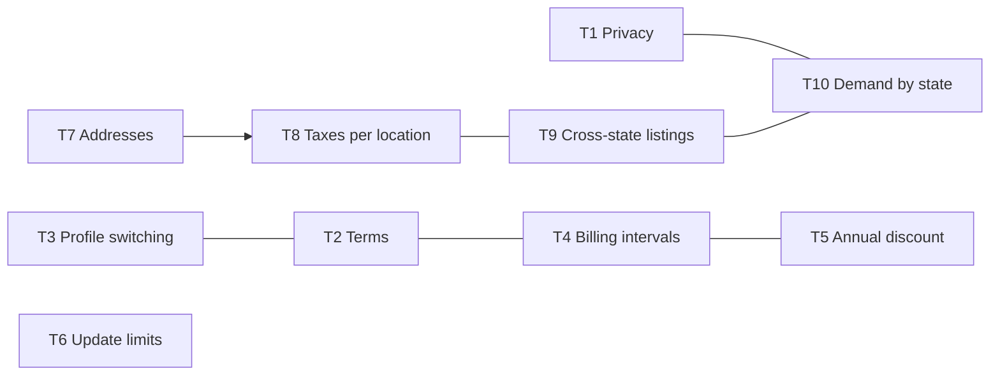

# BlackPages.io: Product To-Do List

| | |
|---|---|
| **Version** | 1.0 |
| **Date** | 2026-09-30 |
| **Owner** | Product owner |
| **Purpose** | Items that need a decision, a spec, or new backlog stories. **None of them has been applied to the MVP definition, specs, or backlog yet.** When an item is decided, apply it everywhere it matters (HANDOFF, section 7), then tick it off here. |

**Status key:** ☐ open · ◐ in progress · ☑ done

---

## Summary

| # | Item | Status | Conflicts with current docs? | Decide by |
|---|---|---|---|---|
| T1 | Privacy policy | ☐ | No | Before Sprint 6 (paid beta) |
| T2 | Terms and conditions | ☐ | No | Before Sprint 1 ends (needed at registration) |
| T3 | Switch profile between business and shopper | ☐ | **Yes:** separate accounts (BR-PE-07), one user per business account (BR-PE-39) | Before Sprint 2 (onboarding) |
| T4 | Quarterly and annual billing for the service fee and listings | ☐ | **Yes:** monthly billing only (BR-PE-08) | Before Sprint 4 (SPEC-BILL-02) |
| T5 | Extra discount for listings paid annually | ☐ | **Yes:** discounts can't be combined | Before Sprint 4 (SPEC-BILL-02) |
| T6 | Limit on listing updates per month | ☐ | No (new entitlement) | Before Sprint 2 (entitlement engine) |
| T7 | Service address and billing address on each account | ☐ | Partly: accounts currently have no addresses | Before Sprint 2 (onboarding) |
| T8 | Multiple taxes configurable per location | ☐ | Partly: story 7.13 and Q12 assume tax is a single open question | Before Sprint 5 (billing goes live) |
| T9 | Cross-state listings only for Platinum | ☐ | **Yes:** every listing belongs to one location (ADR-0008) | Before Sprint 4 (search and SEO) |
| T10 | Track which states requests come from, to prioritize launches | ☐ | No (extends analytics) | Before Sprint 5 (tracking) |

---

## T1. Privacy policy ☐

**What:** a published privacy policy that matches what the platform actually does with personal data.

**Already in the docs:** story 13.4 (static pages), 15.5 (privacy compliance), 11.3 (cookie consent), and system overview section 8.11 (privacy rules).

**To do**
- [ ] Draft the policy. It needs to cover:
  - the data collected from businesses, shoppers, and visitors;
  - the purposes;
  - **analytics and the state-level location tracking in T10**;
  - who data is shared with (Stripe, Postmark, Google Maps, AWS);
  - retention periods;
  - user rights (access, deletion);
  - cookies;
  - how secret shopper data is handled.
- [ ] Get a legal review, covering the states BlackPages will operate in.
- [ ] Set the analytics retention period (it's also needed for SPEC-ANL-01).
- [ ] Version the policy and show the effective date. Decide whether material changes need user notification.
- [ ] Link the policy from registration, the cookie banner, and the footer.

**Affects:** MVP section 8, backlog 13.4, 15.5, and 11.3, and system overview 8.11.

---

## T2. Terms and conditions ☐

**What:** terms that every user accepts, with records of which version they accepted.

**To do**
- [ ] Decide whether to have **one set of terms or separate terms** for:
  - business accounts (listing content rules, billing, auto-renewal, cancellation, refunds);
  - shopper accounts;
  - the **secret shopper program** (confidentiality, conduct, any incentives).
- [ ] Have acceptance required at registration. Keycloak has a built-in "terms and conditions" required action. Alternatively, the app's onboarding step can collect it.
- [ ] Store acceptance in the application database: user, terms version, timestamp, and IP address.
- [ ] Define what happens when terms change: users accept again at their next login.
- [ ] Include auto-renewal and cancellation disclosures for subscriptions, which ties in with T4.
- [ ] Get a legal review.

**Proposed backlog change:** a new story in E2 (about 3 points, Sprint 1–2) for acceptance and versioning, plus content in 13.4.

**Affects:** the identity design (registration and onboarding flow), backlog 2.1, 2.2, and 13.4.

---

## T3. Switch profile between business and shopper ☐

**What:** one person can move between their business and shopper identities without logging out.

**Conflicts with current docs**
- SPEC-BILL-01, BR-PE-07 treats them as **two separate accounts, each with its own $1 service fee**. Question OQ-6 is still open.
- BR-PE-39 says each business account has exactly one user.

**Proposed approach**
- [ ] Keep **one login (`app_user`)** that can own **one business account and one shopper account**. The data model already allows this.
- [ ] Add an **active profile** to the session (BUSINESS or SHOPPER) and a profile switcher in the header. `/api/auth/me` returns the active profile and the profiles available.
- [ ] Apply authorization and entitlements to the **active** profile. For example, reviews are written as the shopper profile. A business must not review its own listings even from its shopper profile.
- [ ] Decide:
  - whether a person can have **both profiles at once**, or **converts** from one to the other;
  - whether having both means **two service fees** (OQ-6);
  - whether a person can own **more than one business account**;
  - **secret shopper selection:** can the same person be selected as both a business and a shopper in the same month?

**Affects:** identity design (sessions, `/api/auth/me`, onboarding), ADR-0007, SPEC-BILL-01 (BR-PE-07 and BR-PE-39), backlog 2.2 and 2.6, and a new story (about 5 points).

---

## T4. Quarterly and annual billing for the service fee and listings ☐

**What:** members can pay for the service fee and their listings **monthly, quarterly, or annually**.

**Conflicts with current docs:** SPEC-BILL-01, BR-PE-08 says monthly only.

**Design notes**
- In Stripe, every item in one subscription must share the **same billing interval**. The simplest model is **one billing interval per account**, chosen at signup and changeable at renewal. The interval then applies to the service fee and every listing ($12 a year for the fee, $3 a quarter).
- Annual billing would **largely solve MVP question Q1** (card fees on $1 invoices).
- Proration, adding listings mid-term, tier changes mid-term, the timing of downgrades, refunds, and lapses all need rules for longer intervals.

**To do**
- [ ] Decide:
  - whether the interval is **per account** (recommended) or per listing;
  - whether members can switch interval mid-term or only at renewal;
  - the refund policy for annual and quarterly payments when a listing is removed or downgraded;
  - renewal reminders, for example 30 days before an annual renewal (this ties in with T2's auto-renewal disclosures).
- [ ] Update SPEC-BILL-01 (BR-PE-08, price versions per interval) and write the rules in **SPEC-BILL-02**.
- [ ] Update ADR-0009 and ADR-0017 (Stripe prices per interval).

**Affects:** SPEC-BILL-01 and SPEC-BILL-02, ADR-0009 and ADR-0017, MVP section 4, backlog 7.1, 7.3, 7.4, 7.5, 7.7, and 13.3, and the data model (`listing_tier_version` and `account_type_config` gain prices per interval).

---

## T5. Extra discount for listings paid annually ☐

**What:** listings paid annually get an additional discount.

**Conflicts with current docs:** each listing can carry only **one** discount, and discounts can't be combined.

**Recommended approach:** treat the annual saving as **interval pricing**, not as a discount. For example, the Gold annual price is set at 12 × the monthly price, less 15%. That means:
- a promotional discount (such as a launch offer) can still apply on top, without breaking the "one discount" rule;
- pricing stays clear on the pricing page ("save 15% with annual billing");
- Stripe handles it naturally as a separate annual price.

**To do**
- [ ] Decide:
  - whether the annual saving is a percentage set by admins, and whether it differs by tier;
  - whether **quarterly** billing also gets a smaller saving;
  - whether a promotional discount can apply **on top of** the annual price (with interval pricing, it can);
  - confirm the saving **never applies to the $1 service fee**, which stays $12 a year (MVP decision D14).
- [ ] Update MVP section 4.4, SPEC-BILL-01, and backlog 7.2 and 7.12.

---

## T6. Limit on listing updates per month ☐

**What:** cap how many times a listing can be updated in a month.

**Design notes:** this fits the entitlement engine as a new listing entitlement, for example `listing.updates.max_per_month`, which can vary by tier (proposed: Silver lowest, Platinum highest).

**To do**
- [ ] Define **what counts as an update**:
  - every save?
  - only changes that go to **approval** (story 3.6)?
  - changes to photos and hours, or only text?

  The recommendation is to count each **submitted change set** that goes to approval, and leave pausing and reactivating uncounted.
- [ ] Decide the limits for each tier.
- [ ] Decide when the count resets: the calendar month in the listing's time zone, or the billing month.
- [ ] Decide whether admins can grant extra updates through an override (SPEC-BILL-01, BR-PE-14).
- [ ] Show remaining updates in the dashboard. Return `ENTITLEMENT_LIMIT_REACHED` when the limit is hit.
- [ ] Decide whether the **first publish** of a new listing counts.

**Affects:** SPEC-BILL-01 sections 4.1 and 4.2, backlog 3.5, 3.6, and 7.10, and the dashboard (2.6).

---

## T7. Service address and billing address on each account ☐

**What:** collect two addresses for each account: a **service address** and a **billing address**.

**To do**
- [ ] **Define "service address"** for each account type:
  - for a business, is it the main business address, and how does it relate to each listing's own address?
  - for a shopper, is it their home address, which is used for location context and secret shopper assignments?
- [ ] The **billing address** goes to the Stripe customer, and is likely to be what **determines tax** (see T8).
- [ ] Decide which fields are required, and whether "same as service address" is offered.
- [ ] Validate addresses with Google Places (story 3.4 already uses it).
- [ ] Privacy: shopper addresses are personal data and must never be shown publicly (see T1).

**Affects:** the data model (`business_account`, `shopper_profile`, or a shared `account_address` table), onboarding (2.2), billing (7.3), identity design section 4, and the system overview data model.

---

## T8. Multiple taxes configurable per location ☐

**What:** each location can have several taxes. Arizona, for example, has a state transaction privilege tax (TPT) and city taxes.

**Design notes**
- This replaces the single open question Q12 and story 7.13 (sales tax) with a **configurable tax model**.
- There are two options:
  - **Configure tax rates ourselves** for each location and city, applied as Stripe tax rates on invoices.
  - **Use Stripe Tax**, which calculates automatically from the customer's address. That means less maintenance, but less control.
- Which address determines tax: billing (T7) or service?

**To do**
- [ ] Get a **tax adviser's** confirmation of which taxes apply to subscriptions in Arizona, and how.
- [ ] Choose between configured rates and Stripe Tax (an ADR is needed).
- [ ] If configured: design `tax_rate` (location, optional city, name, rate, inclusive or exclusive, effective dates) with an admin UI and audit log.
- [ ] Show tax on checkout, invoices, and the pricing page (prices with or without tax).
- [ ] Update story 7.13 (likely from TBD to Must), MVP Q12, and SPEC-BILL-02.

---

## T9. Cross-state listings only for Platinum ☐

**What:** only Platinum listings can be listed across state lines.

**Conflicts with current docs:** every listing belongs to exactly **one location** (ADR-0008), and service areas are cities or a radius within that location.

**To do**
- [ ] **Define "cross-state listing".** It could mean:
  - a listing that **appears in the directories of other states** (for example, an Arizona business also shown in Nevada);
  - a **service area** that crosses a state border;
  - or both.
- [ ] Add a listing entitlement, for example `listing.cross_state` (Platinum only), and possibly a cap on how many extra states.
- [ ] Decide **which state's rules apply**: tax (T8), approval by which site operator, and SEO pages in which state.
- [ ] Decide whether a cross-state listing can appear in **states that aren't live yet**. This interacts with T10.
- [ ] Decide what happens on a **downgrade from Platinum**: the listing is hidden from the other states but kept, consistent with BR-PE-23.
- [ ] Update ADR-0008 (a listing gets one **home location** plus optional **additional locations**), the data model (`listing_location`), search, SEO sitemaps, and operator access rules.

**Affects:** ADR-0008, the system overview (data model, location scoping), SPEC-BILL-01 section 4, backlog E1, E3, E5, and E6.

---

## T10. Track which states requests come from, to prioritize launches ☐

**What:** measure demand by state, so the next locations to go live can be chosen with data.

**Design notes**
- CloudFront can pass the viewer's **country and region** in request headers, so the state can be derived **without storing IP addresses**.
- There are two signals worth capturing:
  1. **Visits and searches by visitor state**, including from states that aren't live yet.
  2. **Explicit interest:** a "Not in your state yet? Get notified when we launch" form for businesses and shoppers, and searches that select a state that isn't live.

**To do**
- [ ] Add `visitor_region` to the event taxonomy (story 0.5) and to `activity_event`. Store the state only, never the IP address.
- [ ] Add a **"notify me when we launch"** capture for states that aren't live. Store the email, the state, the role (business or shopper), and consent.
- [ ] Build an **admin dashboard of demand by state**: visits, searches, interest sign-ups, and businesses that tried to register (story 12.2 or a new story).
- [ ] When a state goes live, email the people who signed up for it (this needs consent, see T1).
- [ ] Reflect this in the privacy policy (T1) and cookie consent (11.3). Note that region-level counts may be allowed without consent, while linking them to a session may not, which needs legal review.

**Affects:** backlog 0.5, 11.1, 11.2, and 12.2, a new story for interest capture (about 3 points), the location selector (1.4), the privacy policy (T1), and system overview sections 8.9 and 8.11.

---

## Dependencies between items

## Suggested order for decisions

1. **Before Sprint 1 refinement ends:** T2 (terms at registration).
2. **Before Sprint 2:** T3, T6, and T7. They affect onboarding, the entitlement engine, and the account data model.
3. **Before Sprint 4:** T4, T5, and T9. They feed SPEC-BILL-02, search, and SEO.
4. **Before Sprint 5:** T8 and T10. They're needed for billing going live and for tracking.
5. **Before Sprint 6 (paid beta):** T1.
